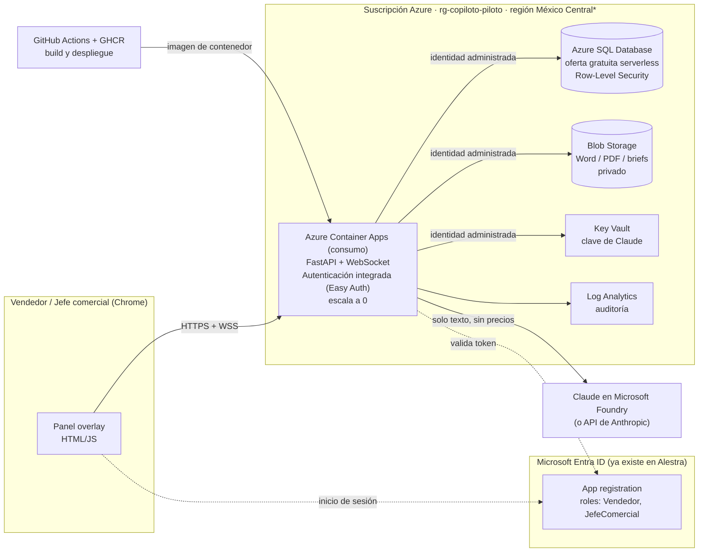

# Arquitectura propuesta · Copiloto Comercial en producción (piloto)

> Propuesta de arquitecto de soluciones para llevar el prototipo del hackathon a un piloto en Alestra.
> Datos SIMULADOS. Los precios de nube están en **dólares (USD), son de lista y aproximados**, y deben
> confirmarse con la calculadora oficial y el contrato de Alestra antes de comprometerlos.

## 1. Decisión en una línea

**Azure, todo en modo «pago por uso que baja a cero»**: Azure Container Apps (consumo) + Azure SQL
Database (oferta gratuita, serverless) + Blob Storage + **Microsoft Entra ID** para iniciar sesión con la
cuenta de Microsoft 365 que los vendedores ya tienen. Claude se consume por **Microsoft Foundry** (factura
de Azure) o por la API de Anthropic. **Infraestructura: ~US$1–10 al mes en el piloto**; el costo variable
real es la IA (~US$0.30–0.60 por reunión).

**Por qué Azure y no AWS:** la identidad de Alestra ya vive en Microsoft (Entra ID / Microsoft 365), así que
el inicio de sesión y los roles salen **sin un servicio extra de identidad**, y Container Apps permite
**apagar el servidor cuando nadie lo usa** sin reescribir el código (el prototipo ya es un contenedor
FastAPI con WebSocket). AWS queda como alternativa equivalente (sección 8).

## 2. Diagrama



\* Verificar que Container Apps y la oferta gratuita de Azure SQL estén disponibles en **México Central**;
si no, usar la región más cercana disponible (p. ej. South Central US) y documentarlo para privacidad.

## 3. Dónde se ejecuta y dónde se guarda cada cosa

| Pieza | Dónde corre / se guarda | Por qué es barato | Costo piloto (aprox.) |
|---|---|---|---|
| Servidor (FastAPI + WebSocket + motor + Word) | **Azure Container Apps**, plan de consumo, 0.5 vCPU / 1 GiB, **mín. 0 réplicas** | Se apaga solo sin uso; incluye cada mes 180,000 vCPU-s, 360,000 GiB-s y 2 M de solicitudes gratis; HTTPS y certificado incluidos | US$0–7/mes |
| Datos (clientes, sesiones, transcripciones, notas, requerimientos, propuestas, aprendizajes, catálogo) | **Azure SQL Database – oferta gratuita** (serverless, 100,000 vCore-s y 32 GB al mes) | Se pausa sola; reemplaza a SQLite sin cambiar el modelo de datos | US$0 dentro del límite |
| Documentos generados (Word, PDF, brief) | **Blob Storage** (Hot LRS), contenedor privado, carpeta por vendedor | ~US$0.02 por GB al mes; política de ciclo de vida para borrar o archivar | < US$1/mes |
| Clave de Claude | **Key Vault** (estándar), leída por identidad administrada | Se cobra por operación (centavos) | < US$0.10/mes |
| Inicio de sesión y roles | **Microsoft Entra ID** de Alestra | Ya incluido en Microsoft 365 | US$0 |
| Bitácora y auditoría | **Log Analytics** (los primeros GB del mes sin costo) | Solo registros de la app | US$0 en piloto |
| Código e imagen | **GitHub** (repo actual) + **GitHub Actions** + **GHCR** | Sin registro de contenedores de pago | US$0 |
| Catálogo y reglas | `catalogo-simulado.json` y `reglas/reglas.json` en el repo; se cargan a SQL en cada despliegue | Cambios auditados por Git (quién, cuándo, por qué) | US$0 |
| IA | **Claude Haiku 5.5** en vivo y **Sonnet 5.5** al cerrar, por **Microsoft Foundry** o API de Anthropic | Catálogo en caché; Haiku cuesta US$0.10 / 0.50 por millón de tokens | ~US$0.30–0.60 por reunión* |

\* Estimación sin medir (la cuenta del hackathon no tenía crédito). Ver sección 7.

**Lo que NO se guarda:** el audio. El navegador lo convierte a texto y solo viaja texto. Claude nunca recibe
precios: solo nombres, descripciones y señales del catálogo.

## 4. Autenticación y permisos

### 4.1 Cómo entra el usuario
1. El vendedor abre `https://copiloto.<dominio-alestra>` y **Easy Auth** (autenticación integrada de
   Container Apps) lo manda a iniciar sesión con su cuenta corporativa de Microsoft (con MFA, si Alestra
   ya la exige). **Nadie anónimo llega a la aplicación.**
2. Entra ID devuelve un token con su **identificador único (`oid`)**, su nombre y sus **roles de aplicación**.
3. Easy Auth pasa esa identidad al servidor en el encabezado `X-MS-CLIENT-PRINCIPAL`. El servidor **solo
   confía en ese encabezado detrás de Easy Auth**: la plataforma lo genera y descarta el que intente mandar
   el navegador.
4. La misma cookie de sesión viaja en la conexión WebSocket, así que la llamada en vivo también queda
   autenticada (validar en el piloto).

### 4.2 Roles (App Roles en Entra ID, asignados por grupos de seguridad)

| Rol | Quién | Grupo de Entra sugerido |
|---|---|---|
| `Comercial.Vendedor` | Cada vendedor | `GRP-Copiloto-Vendedores` |
| `Comercial.Jefe` | Jefe(s) comercial(es) | `GRP-Copiloto-Jefes` |
| `Comercial.Arquitecto` (opcional) | Arquitectos de soluciones | `GRP-Copiloto-Arquitectos` |
| `Copiloto.Admin` | TI / dueño del catálogo | `GRP-Copiloto-Admin` |

**Equipos:** para que el jefe vea **solo a sus vendedores**, se crea un grupo por equipo
(`GRP-Copiloto-Equipo-Norte`, …) o se usa el campo **«jefe directo» (manager)** de Entra, sincronizado
una vez al día con Microsoft Graph. Si hay un solo jefe comercial, basta con que su rol vea todo.

> Asignar **grupos** a una aplicación requiere Entra ID P1 (incluido en Microsoft 365 E3/E5). Si no se
> tiene, se asignan los usuarios uno por uno; el diseño no cambia.

### 4.3 Qué puede ver cada quien

| Recurso | Vendedor | Jefe comercial | Arquitecto | Admin |
|---|---|---|---|---|
| Iniciar una llamada con el copiloto | ✓ | ✓ | — | — |
| Sesiones, transcripciones y notas | **solo las suyas** | **las de su equipo** | las que le asignen | — |
| Propuestas Word/PDF | solo las suyas | las de su equipo | — | — |
| Brief para arquitecto | solo los suyos | los de su equipo | **los asignados a él** | — |
| Tablero de ventas del equipo (propuestas, triaje, tiempo a propuesta, % estándar) | — | ✓ | — | — |
| «Lo que ha aprendido» (frase → producto, sin datos del cliente) | ver | ver y **depurar** | ver | ver |
| Catálogo y reglas | ver | ver | ver | **cambiar (vía Git)** |

### 4.4 El permiso se revisa en tres capas (defensa en profundidad)
1. **Entrada:** Easy Auth bloquea a quien no inició sesión con Alestra.
2. **Aplicación:** cada consulta pasa por una función `usuario_actual()` que agrega el filtro
   `vendedor_oid = <usuario>` o, si es jefe, `equipo_id IN (<sus equipos>)`. Los documentos se descargan
   con un **enlace temporal de 5 minutos** (SAS) que se genera solo después de revisar el permiso.
3. **Base de datos:** **Row-Level Security** de Azure SQL. Aunque el código tuviera un error, la base no
   devuelve filas ajenas:

```sql
-- Esquemático: el servidor fija el contexto al abrir cada conexión
-- EXEC sp_set_session_context 'oid', @oid, @read_only = 1;  (y 'rol', 'equipos')
CREATE FUNCTION seg.fn_puede_ver(@vendedor_oid UNIQUEIDENTIFIER, @equipo_id INT)
RETURNS TABLE WITH SCHEMABINDING AS RETURN
  SELECT 1 AS permitido
  WHERE @vendedor_oid = CAST(SESSION_CONTEXT(N'oid') AS UNIQUEIDENTIFIER)
     OR (CAST(SESSION_CONTEXT(N'rol') AS NVARCHAR(20)) = N'jefe'
         AND CHARINDEX(CONCAT(N',', @equipo_id, N','),
                       CAST(SESSION_CONTEXT(N'equipos') AS NVARCHAR(4000))) > 0);

CREATE SECURITY POLICY seg.politica_ventas
  ADD FILTER PREDICATE seg.fn_puede_ver(vendedor_oid, equipo_id) ON dbo.sesiones,
  ADD FILTER PREDICATE seg.fn_puede_ver(vendedor_oid, equipo_id) ON dbo.propuestas
  WITH (STATE = ON);
```

Además, **cada consulta de un jefe a datos de un vendedor queda en la tabla `auditoria`** (quién, qué,
cuándo) y en Log Analytics.

### 4.5 Sin contraseñas guardadas
El servidor usa **identidad administrada** para entrar a Azure SQL, Blob Storage y Key Vault. GitHub
Actions despliega con **credenciales federadas (OIDC)**, sin secretos de Azure guardados en GitHub.

## 5. Privacidad y retención

| Dato | Retención sugerida (ajustar a la política de Alestra) |
|---|---|
| Transcripción de la llamada | 90 días, después se borra (se conservan notas y citas usadas) |
| Propuestas y briefs | Según la política comercial (p. ej. 2 años) |
| Aprendizajes (frase → producto) | Indefinida; son frases cortas sin datos de contacto, curadas por el jefe |
| Consentimiento de grabación | Se guarda con fecha y usuario en cada sesión |

- Los datos de clientes se quedan en la suscripción de Alestra (región México si está disponible).
- Al usar Claude por **Microsoft Foundry**, el procesamiento queda bajo el contrato de Azure de Alestra;
  por la **API de Anthropic**, bajo los términos comerciales de Anthropic. **Validar con Legal** cuál
  conviene para datos de clientes (LFPDPPP).
- **Ojo con el reconocimiento de voz del prototipo:** el de Chrome envía el audio a servidores de Google.
  Para producción se recomienda **Azure AI Speech** dentro de la suscripción de Alestra (sección 9).

## 6. Despliegue (de este repo a Azure)

1. `Dockerfile` con el servidor actual (`uvicorn app.main:app`).
2. GitHub Actions: pruebas (`pytest`) → construir imagen → publicar en GHCR → `az containerapp update`.
3. Container Apps: ingreso HTTPS, **afinidad de sesión** (la llamada en vivo vive en memoria de una réplica),
   mín. 0 / máx. 2 réplicas en el piloto; si se quiere evitar el arranque en frío en horario laboral,
   mín. 1 réplica de lunes a viernes 8–19 h con una regla de escalado por horario.
4. Easy Auth activado con «requerir autenticación» y el proveedor Microsoft (Entra ID).

## 7. Costo estimado del piloto (20 vendedores, 2 jefes)

| Concepto | Supuesto | US$/mes (aprox.) |
|---|---|---|
| Container Apps | ~220 h activas al mes; lo que exceda la cuota gratuita | 0–7 |
| Azure SQL Database | Oferta gratuita (100,000 vCore-s, 32 GB) | 0 |
| Blob Storage | < 10 GB de documentos | < 1 |
| Key Vault + Log Analytics | Uso bajo | < 1 |
| Entra ID, GitHub, GHCR | Ya existentes / gratis | 0 |
| **Infraestructura total** | | **~1–10** |
| **IA (Claude)** | 20 vendedores × 2 reuniones/día × 22 días = 880 reuniones × US$0.30–0.60 | **~260–530** |

**Cómo bajar el costo de IA sin perder calidad** (en orden):
1. Analizar **cada 15 s o cada 3 frases** en vez de cada frase (hoy se acumula solo si hay un análisis en
   curso). Estimado: −40 a −60%.
2. Mantener el catálogo en caché (ya está hecho) y **no** llamar a Sonnet si el vendedor no cierra la sesión.
3. Medir el costo real por reunión (tokens que devuelve la API) **antes** de escalar más allá del piloto.

Referencia de valor: una sola propuesta que no tiene que esperar 3 semanas, o una reunión de arquitecto
que se evita, cuesta más que cientos de reuniones con el copiloto.

## 8. Alternativa en AWS (equivalente)

| Pieza | AWS | Nota de costo |
|---|---|---|
| Servidor | **AWS App Runner** (o Lightsail Containers) | App Runner no baja a cero: ~US$5–25/mes |
| Inicio de sesión | **Amazon Cognito** federado con **Entra ID** (OIDC/SAML) y grupos → roles | Costo bajo con pocos usuarios, pero es **un servicio más** que configurar |
| Datos | **Aurora Serverless v2** con pausa automática, o **DynamoDB** (capa gratuita) | Aurora: aislamiento por fila con políticas de PostgreSQL (RLS) |
| Documentos | **S3** privado + URL prefirmadas de 5 min | Centavos |
| Clave | **Secrets Manager** | ~US$0.40 por secreto al mes |
| IA | **Claude en Amazon Bedrock** | JSON estricto y caché disponibles |

Elegir AWS si el área comercial ya tiene su cuenta y su red ahí; si no, Azure sale más simple por la
identidad de Microsoft 365.

## 9. Fases

| Fase | Qué se hace | Cambio en el código |
|---|---|---|
| **0 · Hoy** | Prototipo local (SQLite, sin usuarios) | — |
| **1 · Piloto (2–3 semanas)** | Azure Container Apps + Easy Auth + Azure SQL + Blob + roles Vendedor/Jefe + tablero del jefe | Columna `vendedor_oid`/`equipo_id` en sesiones y propuestas; `usuario_actual()` en cada endpoint y en el WebSocket; SQLite → Azure SQL; `salidas/` → Blob; `Dockerfile` y GitHub Actions |
| **2 · Audio de la llamada** | **Azure AI Speech** con identificación de quién habla (diarización), capturando el audio de la pestaña de Teams/Meet | Reemplaza el reconocimiento de Chrome; el resto del sistema no cambia porque ya recibe frases por WebSocket |
| **3 · Integraciones** | CRM (oportunidad creada con la propuesta), catálogo real desde la fuente de Alestra, red privada si Seguridad lo exige | Conectores; endpoints privados (~US$7–10/mes cada uno) |

## 10. Riesgos y cómo se cubren

| Riesgo | Mitigación |
|---|---|
| Un vendedor ve datos de otro | Tres capas: Easy Auth, filtro en la app y Row-Level Security en la base; pruebas automáticas por rol |
| La IA inventa un producto o precio | Ya resuelto en el prototipo: Claude no ve precios, esquema estricto, verificación de citas, motor determinista |
| Arranque en frío de 5–15 s | Réplica mínima en horario laboral (+ ~US$20–30/mes) |
| Se rebasa la cuota gratuita de Azure SQL | La base se pausa o pasa a cobro por uso (unos dólares); alertas de presupuesto en Azure |
| Costo de IA mayor al estimado | Medición por reunión desde el primer día; límite de gasto mensual en la consola; análisis cada 15 s |
| Datos de clientes fuera de México | Región México Central si está disponible; Foundry dentro del contrato de Azure; revisión de Legal |
